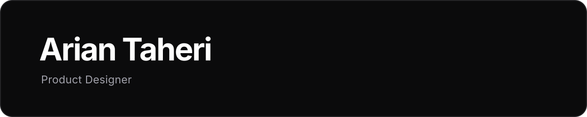

<!-- Profile README: https://github.com/ariantaheri -->

  
  

    <a href="https://ariantaheri.framer.ai/">Portfolio</a>
    &nbsp;·&nbsp;
    
    &nbsp;
    
    &nbsp;
    
    &nbsp;
    
    &nbsp;
    
  

---

I'm a Product Designer focused on turning complex user and business problems into clear, intuitive digital experiences.

My work spans product discovery, UX research, interaction design, and design systems. I combine user insights, product data, and thoughtful execution to improve products from idea to implementation.

## Areas of focus

- Product discovery and strategy
- UX research and usability testing
- Information architecture and interaction design
- Design systems and design tokens
- Accessibility and data-informed iteration

---

  Designing thoughtful, useful digital products.

